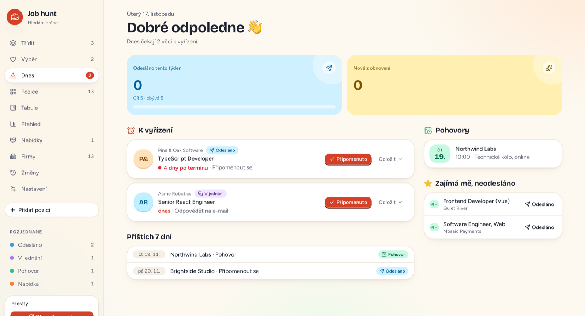
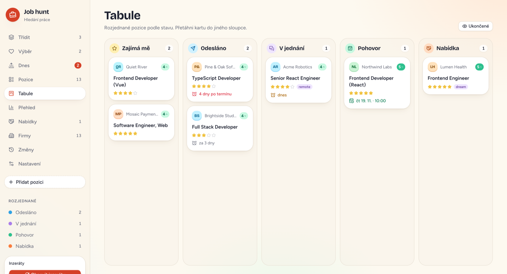

# Job hunt

A self-hosted tracker for a job search. It collects postings from Czech job boards, lets you sort them like a deck of cards, and follows every application from the first e-mail to the offer. The interface is in Czech.





The screenshots show made-up data.

## What it does

- **Collects postings** from Úřad práce open data, StartupJobs, jobs.cz, LinkedIn and others, re-checks them daily and marks the ones that disappeared.
- **Sorts them fast**: a swipe deck with one card per new posting, best match first.
- **Tracks applications** through a status pipeline with history, follow-up reminders, interviews, tasks, offers and a calendar feed.
- **Shows how the search is going**: sent per week, answer rate, funnel, results per source.
- **Optional AI help**: short summaries of postings and a prepared application for each shortlisted role, through the Claude Code CLI.

## Stack

| Part | Technology |
|---|---|
| Frontend | Vue 3, TypeScript, Vite, Tailwind CSS 4, shadcn-vue (Reka UI), MiniSearch |
| Backend | Node, Hono, SQLite through the built-in `node:sqlite` |
| Tests | Vitest, about 100 tests |
| Deployment | One Docker container, data in a mounted volume |

## Reading the code

```
shared/   types and rules used by both sides
server/   API, database, refresh job, AI queues
src/      Vue app
tests/    unit tests for the rules, the store and the API
```

Good places to start:

| File | What is there |
|---|---|
| `shared/types.ts` | The data model: listing, company, application state, settings. |
| `shared/pipeline.ts` | The rules of the status pipeline as pure functions: what a status change plans next, when to offer "no answer". |
| `server/db.ts` | SQLite schema and migrations, versioned with `PRAGMA user_version`. |
| `server/store.ts` | The queries: loading and saving every kind of record. |
| `server/index.ts` | The HTTP routes. |
| `server/sources/` | One file per job board behind a common interface (`types.ts`), registered in `index.ts`. Official data and APIs come first; HTML is read only where a portal offers nothing else. |
| `server/refresh.ts` | The refresh job: re-check open postings, search the sources, add what is new. |
| `server/guard.ts`, `server/auth.ts` | Request guard (host, origin, content type) and the single-password login with a lockout. |
| `server/summary.ts`, `server/kit.ts`, `server/chat.ts` | Prompts and parsing for the AI features: summaries, application kits, the interview-prep chat. The call that searches the web gets no personal data; the calls that know my profile get no tools. |
| `src/pages/` | One file per page. `src/store.ts` holds the client state, `src/filters.ts` and `src/search.ts` the filtering and full-text search. |

`data/` (the database, backups, uploaded documents) is not in git. It is personal, and rolling back code should not roll back notes.

## Run

Needs Node 24 and pnpm.

```sh
pnpm install
pnpm dev        # app on http://localhost:5173, API on http://localhost:5174
```

| Command | What it does |
|---|---|
| `pnpm test` | Unit tests |
| `pnpm typecheck` | Type check |
| `pnpm refresh` | Re-check open listings and search for new ones, from the terminal |
| `pnpm refresh --check-only` | Only re-check the listings already in the list |
| `pnpm build && pnpm start` | Built app and API together on http://localhost:5174 |

Optional API keys go into `.env` (copy `.env.example`).

## More

- [User guide](docs/guide.md): the flow, statuses, e-mail, keyboard shortcuts, backups.
- [Sources and refresh](docs/sources.md): where postings come from and how each source is read.
- [AI summaries, application kits and interview preparation](docs/ai.md): what is generated, with which model, and how personal data is kept apart.
- [Hosting](docs/hosting.md): Docker, environment variables, login.

UI components are generated with [shadcn-vue](https://www.shadcn-vue.com) into `src/components/ui/`; theme tokens are in `src/styles.css`.
